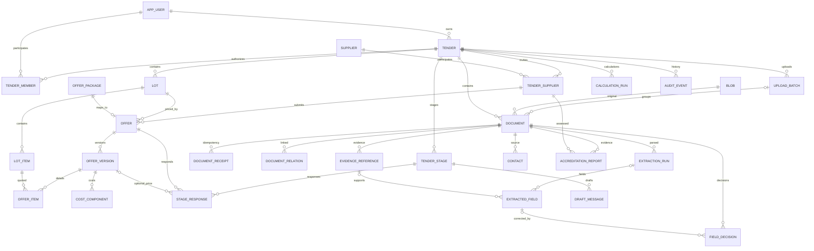

# TASK-003 proposed ERD

DDL authority: [002](../infra/migrations/002_domain_foundation.sql), extending unchanged [001](../infra/migrations/001_initial.sql). Not yet applied. UUID keys; composite foreign keys prevent cross-tender and cross-lot associations. Legacy tables specification_item, comparison and comparison_offer remain intact; they are not silently remapped.

Historical offer versions without a reviewed lot mapping are the explicit exception to Offer cardinality. No fabricated mapping is made. The ERD abbreviates nullable stage/supplier/source-document references; see DDL for every constraint and [ADR](./ADR-003-persistence.md) for unresolved mappings.
